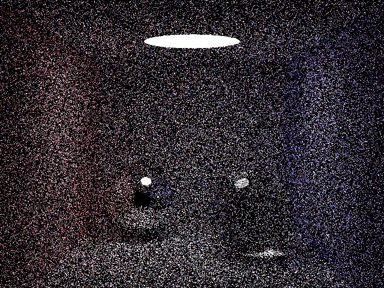
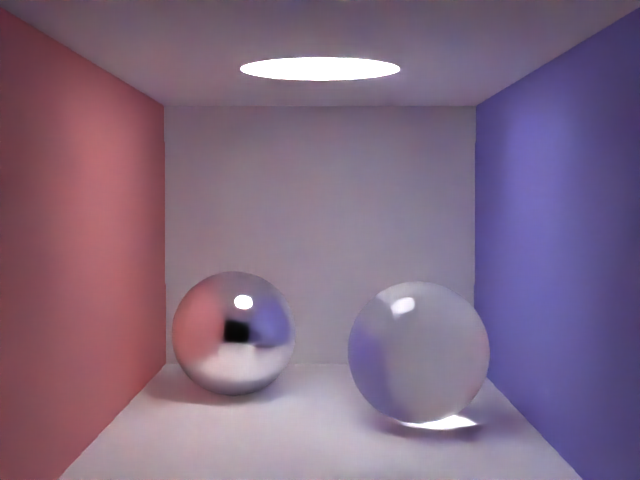
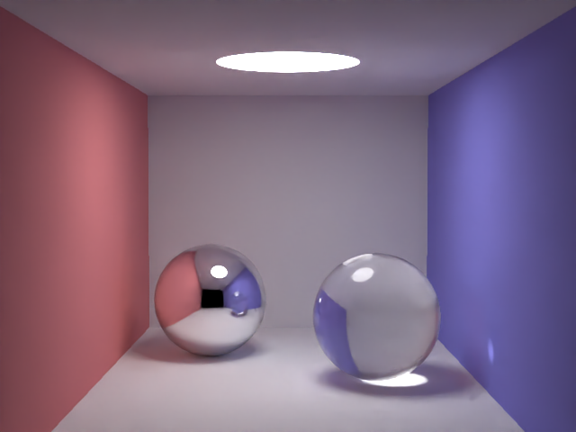

# vk_smallpt

[smallpt](https://www.kevinbeason.com/smallpt/) — Kevin Beason's 99-line path tracer — rewritten as
**Vulkan compute kernels compiled by [clspv](https://github.com/google/clspv)**, and denoised on the
same GPU by **Intel OpenImageDenoise's U-Net rebuilt as Vulkan compute passes**. Plain Vulkan C++ on
the host, no VMA, no glfw, no OIDN library, no SYCL/oneDNN.

The point of the repository is the compiler side: the same scene is shipped as six kernel sources
and eight builds (OpenCL C, C++ for OpenCL, GLSL, with and without the clspv workarounds) so the
cost of each code generation choice can be measured on one machine, and the denoiser shows a real
30-dispatch compute chain next to the path tracer.

| 1 spp, no denoise | 1 spp + Vulkan OIDN | 64 spp + Vulkan OIDN |
| --- | --- | --- |
|  |  |  |

## What is in here

- `vkcompute` — the minimal example: `out[i] = a[i] + b[i]` over 1M floats, kernel in OpenCL C
  (`src/vadd.cl`), host in plain Vulkan, result validated element by element on the CPU.
- `smallpt` — the path tracer. Kernel in **C++ for OpenCL** (`src/smallpt_cpp.cl`) compiled by clspv,
  host in plain Vulkan, PNG written by the in-tree encoder (`src/png_writer.cpp`). The kernel also
  writes an albedo and a normal image (a first-hit G-buffer) for the denoiser.
- **OpenImageDenoise as Vulkan compute** — `src/oidn_denoise.cpp` runs OIDN's RT U-Net from its
  published weights: six pass types, 30 dispatches per tile, FP16 tensor storage by default. Each
  pass exists twice, as GLSL (`src/oidn_*.comp`, glslc) and as C++ for OpenCL (`src/oidn_*.cl`,
  clspv); the C++ for OpenCL set is the default backend.
- **Kernel comparison builds** — `smallpt_c` (OpenCL C, scene in `__constant`), `smallpt_buf`
  (scene read from the parameter buffer), `smallpt_native` (buffer + native `sin`/`cos` +
  `--cl-fast-relaxed-math`), `smallpt_lit` (literal subscripts, the fastest clspv build),
  `smallpt_glsl` / `smallpt_lit_glsl` (the same kernels in GLSL through glslc),
  `smallpt_cpp` (C++ for OpenCL, plain `-O3`), plus the shipping `smallpt.spv`.
- Tools: `oidn_denoise_tool` (standalone denoiser, raw float32 in/out), `conv_probe` (one
  convolution pass against a CPU reference), `tools/oidn/ref_forward.py` (numpy reference of the
  whole network), `tools/oidn/export_oidn_weights.py` (turns OIDN's `rt_hdr.tza` into the flat
  float32 blobs in `tools/oidn/`).

## Requirements

| | |
| --- | --- |
| Vulkan SDK | 1.4.x, with `glslc` and `spirv-opt` (verified with 1.4.357) |
| CMake | ≥ 3.20 |
| C++ compiler | MSVC 2022 / any C++17 compiler |
| clspv | built from source (LLVM + Clang + libclc); must support `--cl-std=CLC++2021` |
| Python 3 | optional, only for `scripts/ppm_diff.py` and the OIDN reference scripts |

clspv does not ship with the Vulkan SDK. Build it from
[google/clspv](https://github.com/google/clspv) the usual way (LLVM/Clang and the libclc builtins
for `spirv32-unknown-vulkan`), then point `CLSPV_ROOT` at the build or install directory — both
`CMakeLists.txt` and `scripts/build_shaders.ps1` look for `<CLSPV_ROOT>/bin/clspv.exe`. If clspv is
not found, the `vadd` example still runs from the committed `shaders/vadd.spv`, but nothing that is
compiled from OpenCL can be built, so `smallpt` is skipped.

## Build and run

Windows (verified):

```powershell
$env:CLSPV_ROOT = "C:\dev\clspv\build"
cmake -S . -B build -G "Visual Studio 17 2022" -A x64
cmake --build build --config Release
```

Linux (not verified here; the shader custom commands are generator-independent):

```bash
export CLSPV_ROOT=$HOME/dev/clspv/build
cmake -S . -B build -DCMAKE_BUILD_TYPE=Release
cmake --build build -j
```

The Vulkan SDK directory is taken from `VULKAN_SDK`; `spirv-opt` and `glslc` are searched there and
in `PATH`.

Minimal compute example:

```powershell
.\build\Release\vkcompute.exe
```

```
[info] device: Intel(R) UHD Graphics (queue family 0)
[info] dispatch: 16384 workgroups x 64 threads = 1048576 work items
PASS: all 1048576 elements match (max |err| = 0)
```

Path tracer — defaults to 640×480 / 64 spp and writes `renders\smallpt.png`:

```powershell
.\build\Release\smallpt.exe
.\build\Release\smallpt.exe build\smallpt.spv 1024 768 256 renders\big.png
```

Arguments are `<spv> <width> <height> <spp> [out.png|out.ppm] [entryPoint]`. `spp` means samples
per subsample, and the kernel takes 2×2 subsamples, so 64 spp is 256 paths per pixel. The entry
point defaults to `smallpt` (a clspv module); a glslc module must be given `main` explicitly.

One-step render and comparison helpers:

```powershell
pwsh -File scripts\render_smallpt.ps1 -Width 1024 -Height 768 -Spp 256
pwsh -File scripts\compare_smallpt.ps1            # all kernel builds, one table
```

`scripts/compare_smallpt.ps1` runs the same host against every module and prints time, throughput,
module size and device memory; it also diffs the GLSL variants and the two C++/OpenCL variants
byte by byte. It switches the denoiser off (`SMALLPT_NO_DENOISE=1`) so the comparison is about the
kernel.

## The denoiser

`oidn_denoise.cpp` reproduces OIDN's RT filter U-Net (`rt_hdr`), the colour-only network plus its
albedo/normal variants, with compute shaders only:

- weights: `tools/oidn/rt_hdr.bin`, `rt_hdr_alb.bin`, `rt_hdr_alb_nrm.bin` (float32, exported from
  OIDN's `weights/*.tza` by `tools/oidn/export_oidn_weights.py`; Apache-2.0, © Intel);
- passes: pre (autoexposure + PU transfer function), 3×3 convolution (shared-memory tiled, 3×2
  pixels per thread and 4 output channels per workgroup by default, register blocked), 2×2 max
  pooling, 2× nearest upsampling into the concat buffer, skip-connection copy, post (inverse PU +
  exposure undo) — 30 dispatches;
- tiling: images larger than the budget (`OIDN_DENOISE_MAX_MB`, default 3000) are cut into
  16-aligned tiles with a 96-pixel overlap, so any resolution works;
- precision: tensors are FP16 when the device offers 16-bit storage (`storageBuffer16BitAccess`),
  weights/shared memory/accumulators stay FP32;
- the weight set follows the inputs: colour only → `rt_hdr`, colour + albedo → `rt_hdr_alb`,
  colour + albedo + normal → `rt_hdr_alb_nrm`. `smallpt` provides albedo and normal by default,
  `SMALLPT_NO_AUX=1` renders colour only.

Environment switches:

| Variable | Effect |
| --- | --- |
| `SMALLPT_NO_DENOISE=1` | skip the denoiser |
| `SMALLPT_NO_AUX=1` | do not feed albedo/normal, select `rt_hdr` weights |
| `OIDN_STORE=fp32` | FP32 tensor storage instead of FP16 |
| `OIDN_BACKEND=glsl` | use the GLSL (`glslc`) passes instead of the C++ for OpenCL ones |
| `OIDN_TILE=PXxPYgGROUP` | pick another tiled-convolution blocking (`2x2g8`, `4x2g4`, `4x3g4`) |
| `OIDN_CONV=simple` | one-pixel-per-thread convolution instead of the tiled kernel |
| `OIDN_PROFILE=1` | per-pass GPU timings |
| `OIDN_DENOISE_MAX_MB=<n>` | tile memory budget |
| `OIDN_DUMP_TENSOR=<prefix>` | dump intermediate tensors |
| `SMALLPT_DUMP_RGBA=<path>` | write the final linear RGB as raw float32 |
| `SMALLPT_DUMP_AUX=<prefix>` | write the albedo/normal images as raw float32 |
| `CLSPV_EXAMPLE_VALIDATION=1` | enable the Vulkan validation layers |

`oidn_denoise_tool` runs the same chain without the renderer:

```powershell
oidn_denoise_tool.exe in.f32 640 480 out.f32 out.ppm [--alb alb.f32] [--nrm nrm.f32]
```

## Measured

Intel UHD Graphics (integrated), Vulkan 1.4.357 vendor driver, MSVC 19.44 release build. 480×360 /
32 spp = 128 paths per pixel, denoiser off, median-free single runs — treat them as orders of
magnitude, not a benchmark:

| Kernel | Elapsed | Mpaths/s | Module |
| --- | --- | --- | --- |
| OpenCL C, scene in `__constant` (`smallpt_c`) | 1352 ms | 16.4 | 98.8 KiB |
| OpenCL C, scene in buffer (`smallpt_buf`) | 1010 ms | 21.9 | 108.2 KiB |
| GLSL (glslc) (`smallpt_glsl`) | 214 ms | 103.2 | 15.9 KiB |
| clspv buffer + native sin/cos (`smallpt_native`) | 267 ms | 83.0 | 36.6 KiB |
| clspv literal subscripts (`smallpt_lit`) | 186 ms | 118.7 | 34.4 KiB |
| GLSL literal subscripts (`smallpt_lit_glsl`) | 177 ms | 125.3 | 21.8 KiB |
| C++ for OpenCL, plain `-O3` (`smallpt_cpp`) | 1002 ms | 22.1 | 108.4 KiB |
| C++ for OpenCL + native/fast (default) | 219 ms | 101.1 | 37.7 KiB |

The GLSL pair and the C++/OpenCL pair render **byte-identical** images (checked by
`scripts/ppm_diff.py`), so the differences above are code generation, not arithmetic. The gap
between the first row and the fast rows is mostly `sin`/`cos`: clspv maps them to libclc's
correctly-rounded software implementations unless `--use-native-builtins=sin,cos` is passed, which
is a ~196-instruction polynomial per call site. The full analysis — including the `__constant`
address space demotion, why literal subscripts remove the `Private` array, and the GLSL equivalent
of the same problem — is in [docs/engineering-notes.md](docs/engineering-notes.md).

Render + denoise, shipping module (`smallpt.spv`), 640×480 / 64 spp:

| Stage | Time |
| --- | --- |
| path tracing | 722.6 ms (108.8 Mpaths/s) |
| OIDN U-Net, FP16 tensors, 1 tile | 304.9 ms (219 MiB of tensors) |
| `smallpt_lit.spv`, 640×480 / 16 spp | 197 ms + 379 ms |

## Verified in this release

- Configure + build with MSVC 2022, Vulkan SDK 1.4.357 and a source-built clspv: all targets,
  including the 7 OIDN passes × {GLSL, C++ for OpenCL} × {FP32, FP16} + 3 tiled-convolution
  alternates.
- `vkcompute`: PASS, all 1,048,576 elements exact.
- `smallpt` at 640×480 / 64 spp with the denoiser: PNG written, image correct.
- All eight kernel builds render the same scene; `smallpt_lit.spv` denoises correctly (auxiliary
  images included).
- `oidn_denoise_tool` on a synthetic 128×96 noisy image: 30-dispatch chain runs, output written.

Not verified: non-Windows builds, AMD/NVIDIA/Android drivers, 32-bit SPIR-V.

## License

MIT, see [LICENSE](LICENSE). `smallpt` is © Kevin Beason; the denoiser weights are derived from
[Intel OpenImageDenoise](https://github.com/OpenImageDenoise/oidn) (Apache-2.0).
